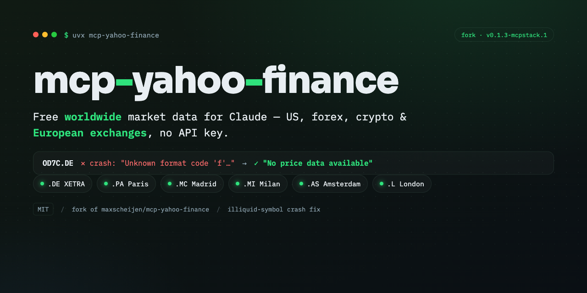
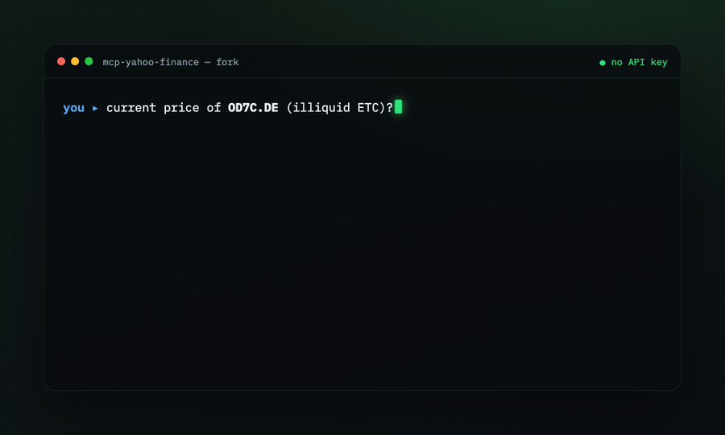

<p align="center">
  
</p>

> ### About this fork
> A fork of [**maxscheijen/mcp-yahoo-finance**](https://github.com/maxscheijen/mcp-yahoo-finance)
> (MIT, © Max Scheijen) maintained for [**claude-mcp-stack**](https://github.com/mgatorr/claude-mcp-stack),
> with an illiquid-symbol crash fix. Pinned release: **`v0.1.3-mcpstack.1`**. Upstream MIT
> license and attribution are preserved; the original upstream README follows further down.

## Why this fork

`get_current_stock_price` formatted the price with a float format code without guaranteeing a
numeric value. On illiquid symbols (e.g. `OD7C.DE` on XETRA) whose `.info` exposes no last
price, it raised:

```text
Unknown format code 'f' for object of type 'str'
```

This fork makes price handling defensive:

- Coerces the value to `float` before formatting (handles numeric strings, `"N/A"`, `None`, `NaN`).
- Falls back to the **last available close** via `history(period="5d")` when `.info` has no price.
- Returns a clear **`No price data available for <symbol>`** instead of crashing or returning empty.
- The same coercion is applied in `get_stock_price_by_date`.
- Covered by tests (mocked `Ticker`): normal, illiquid with/without history, `"N/A"`, `NaN`, and
  unknown symbols — none raise.

| Symbol | Upstream (PyPI) | This fork |
|--------|-----------------|-----------|
| `UNH`, `8PSG.DE` | price | price |
| `OD7C.DE` (illiquid) | **crash** | `No price data available for OD7C.DE` |
| unknown ticker | error/crash | `No price data available for <symbol>` |

<p align="center">
  
</p>

## Install this fork (with the fix)

> ⚠️ `uvx mcp-yahoo-finance` / `pip install mcp-yahoo-finance` (the upstream instructions below)
> install the **published upstream package, which does _not_ contain this fix**. To get the fix,
> build from this fork:

```sh
git clone --branch v0.1.3-mcpstack.1 https://github.com/mgatorr/mcp-yahoo-finance.git
cd mcp-yahoo-finance
uv venv
uv pip install -e .
# Built entry point:
#   macOS/Linux : .venv/bin/mcp-yahoo-finance
#   Windows     : .venv\Scripts\mcp-yahoo-finance.exe
```

Point your client at that binary (use the **absolute** path):

```jsonc
// Claude Desktop: claude_desktop_config.json   ·   Claude Code: .mcp.json
{
  "mcpServers": {
    "yahoo-finance": {
      "command": "/absolute/path/to/mcp-yahoo-finance/.venv/bin/mcp-yahoo-finance"
    }
  }
}
```

No API key is required. (Or let [claude-mcp-stack](https://github.com/mgatorr/claude-mcp-stack)
install it for you.)

## Tools

| Tool | Returns |
|------|---------|
| `get_current_stock_price` | Current price (fixed: safe on illiquid/unknown symbols) |
| `get_stock_price_by_date` | Close price on a specific date |
| `get_stock_price_date_range` | Close prices across a date range |
| `get_historical_stock_prices` | OHLC history for a period/interval |
| `get_dividends` | Dividend history |
| `get_income_statement` | Income statement (yearly/quarterly/trailing) |
| `get_cashflow` | Cash-flow statement |
| `get_earning_dates` | Upcoming and past earnings dates |
| `get_news` | Recent news for a symbol |
| `get_recommendations` | Analyst recommendations |
| `get_option_expiration_dates` | Available options expiration dates |
| `get_option_chain` | Options chain for an expiration date |

## Worldwide coverage (free, no key)

Yahoo Finance symbols use exchange suffixes — handy because Twelve Data's free tier excludes
Europe:

| Suffix | Exchange | Example |
|--------|----------|---------|
| *(none)* | US | `AAPL` |
| `.DE` | XETRA (Germany) | `8PSG.DE` |
| `.PA` | Euronext Paris | `MC.PA` |
| `.MC` | BME Madrid (IBEX) | `SAN.MC` |
| `.MI` | Borsa Italiana (Milan) | `ENI.MI` |
| `.AS` | Euronext Amsterdam | `ASML.AS` |
| `.L` | London Stock Exchange | `HSBA.L` |

> Yahoo data may be delayed or end-of-day depending on the exchange, and has occasional gaps
> for thinly-traded instruments. Not affiliated with Yahoo.

## Develop & test

```sh
uv venv && uv pip install -e .
uv run pytest -q   # mocked-Ticker tests; offline and deterministic
```

---

*The original upstream README follows.*

# MCP Yahoo Finance


A [Model Context Protocol](https://modelcontextprotocol.io) (MCP) server for Yahoo Finance interaction. This server provides tools to get pricing, company information and more.

> Please note that `mcp-yahoo-finance` is currently in early development. The functionality and available tools are subject to change and expansion as I continue to develop and improve the server.

## Installation

You don't need to manually install `mcp-yahoo-finance` if you use [`uv`](https://docs.astral.sh/uv/). We'll use [`uvx`](https://docs.astral.sh/uv/guides/tools/) to directly run `mcp-yahoo-finance`.

I would recommend using this method if you simply want to use the MCP server.

### Using pip

Using `pip`.

```sh
pip install mcp-yahoo-finance
```

### Using Git

You can also install the package after cloning the repository to your machine.

```sh
git clone git@github.com:maxscheijen/mcp-yahoo-finance.git
cd mcp-yahoo-finance
uv sync
```

## Configuration

### Claude Desktop

Add this to your `claude_desktop_config.json`:

```json
{
    "mcpServers": {
        "yahoo-finance": {
            "command": "uvx",
            "args": ["mcp-yahoo-finance"]
        }
    }
}
```
You can also use docker:

```json
{
    "mcpServers": {
        "yahoo-finance": {
            "command": "docker",
            "args": ["run", "-i", "--rm", "IMAGE"]
        }
    }
}
```

### VSCode

Add this to your `.vscode/mcp.json`:

```json
{
    "servers": {
        "yahoo-finance": {
            "command": "uvx",
            "args": ["mcp-yahoo-finance"]
        }
    }
}
```

## Examples of Questions

1. "What is the stock price of Apple?"
2. "What is the difference in stock price between Apple and Google?"
3. "How much did the stock price of Apple change between 2024-01-01 and 2025-01-01?"
4. "What are the available options expiration dates for AAPL?"
5. "Show me the options chain for AAPL expiring on 2024-01-19"
6. "What are the call and put options for Tesla?"

## Build

Docker:

```sh
docker build -t [IMAGE] .
```

## Test with MCP Inspector

```sh
npx @modelcontextprotocol/inspector uv run mcp-yahoo-finance
```
